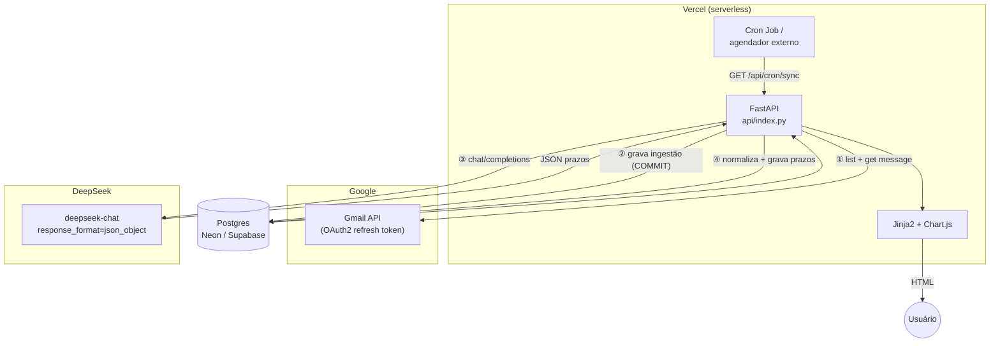
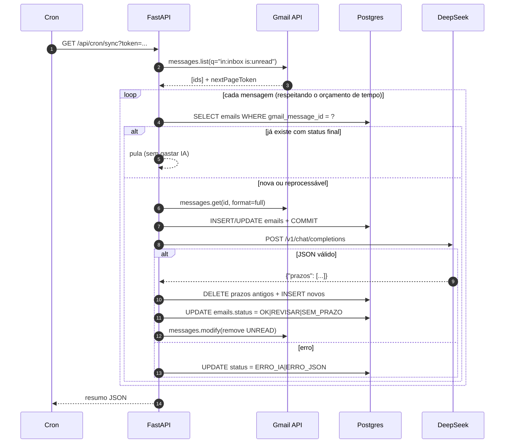
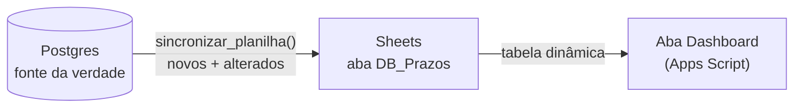
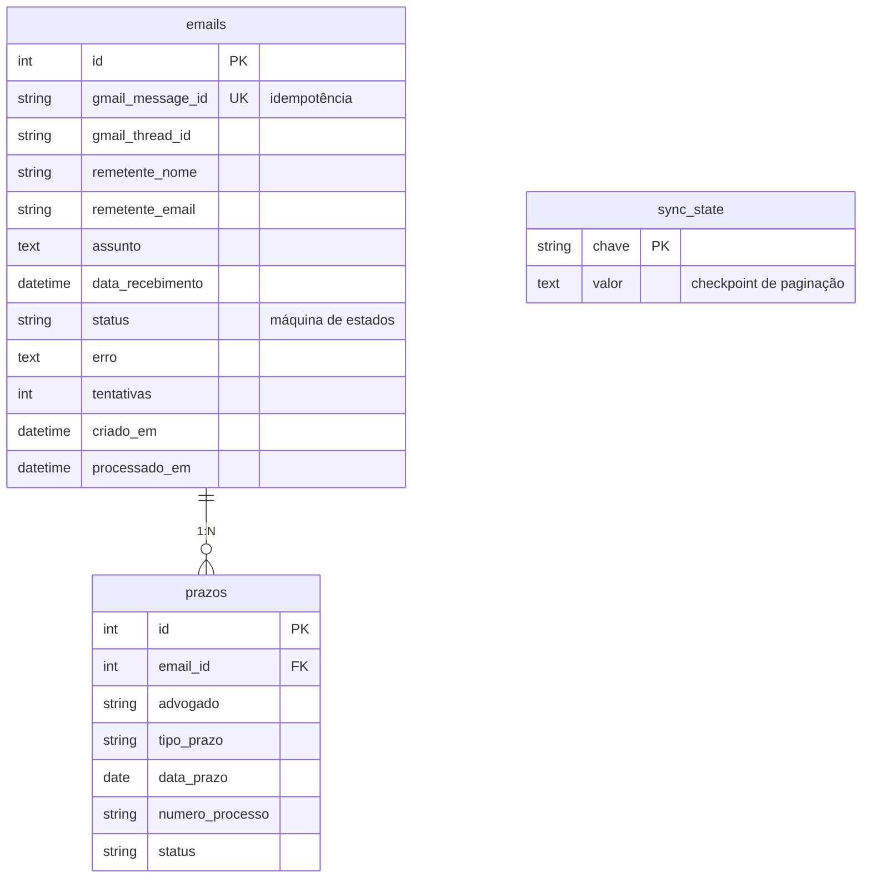
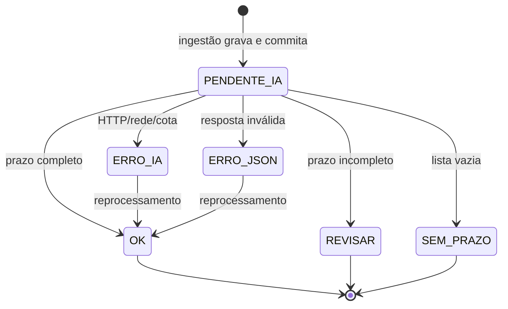

# Planejamento — Automação de Prazos Jurídicos

> **Projeto:** leitura de e-mails de protocolo no Gmail → extração estruturada de prazos com
> LLM (DeepSeek) → persistência relacional → dashboard de produtividade por advogado.
>
> **Stack:** Python 3.12 · FastAPI · SQLAlchemy 2 · Jinja2 + Chart.js · deploy serverless na Vercel.
> **Versão do documento:** 2.0 (substitui o plano original em Google Apps Script).
> **Última atualização:** 06/11/2026

---

## 1. Sumário executivo

O escritório recebe, na caixa de entrada do Gmail, e-mails de protocolo/intimação que informam
prazos processuais. O controle manual (ler → identificar advogado, tipo, data-limite e número do
processo → lançar numa planilha) não escala e não gera indicadores.

A **Fase 1** automatiza o ciclo de ponta a ponta:

1. **Ingestão determinística** — o sistema busca as mensagens e grava, **antes de qualquer IA**,
   o que o Gmail já fornece: remetente (nome e e-mail), assunto, data/hora de recebimento,
   `message_id` e `thread_id`.
2. **Enriquecimento** — o corpo do e-mail é enviado ao `deepseek-chat`, que devolve **JSON estrito**.
3. **Normalização** — datas e números de processo são revalidados em Python.
4. **Persistência** — um registro em `emails` e N em `prazos`.
5. **Apresentação** — dashboard com a matriz *Advogado × Tipo de Prazo* (a antiga tabela dinâmica,
   agora uma agregação SQL).

O desenho "**grava primeiro o que a máquina sabe, enriquece depois com IA**" é deliberado: se a API
da IA falhar, estourar cota ou devolver lixo, o dado de ingestão **não é perdido** e a mensagem fica
marcada para reprocessamento.

---

## 2. Por que sair do Apps Script

| Requisito | Apps Script | Python na Vercel |
|---|---|---|
| Versionamento / CI | Limitado (clasp) | Git + pipeline padrão |
| Testes automatizados | Praticamente inviável | `pytest` (84 testes) |
| Dashboard | Tabela dinâmica na planilha | HTML/Chart.js + API JSON |
| Consultas | Percorrer planilha inteira | SQL com índices |
| Integrações futuras | Difícil | Qualquer biblioteca Python |
| Custo | Cota do Google | Plano gratuito generoso |

O que se **manteve** do desenho original: ingestão em duas etapas, idempotência por `Message ID`,
máquina de estados com reprocessamento, normalização defensiva e prompt com `json_object`.

---

## 3. Arquitetura



### 3.1 Responsabilidades

| Módulo | Responsabilidade |
|---|---|
| `services/gmail.py` | OAuth2 (refresh token), listagem paginada, `messages.get`, `messages.modify`, decoding MIME |
| `services/deepseek.py` | Prompt, chamada HTTP com retry/backoff, parse tolerante |
| `services/extracao.py` | Regex determinística: nº do processo (assunto), datas, tipos de prazo |
| `services/normalizacao.py` | Datas, número CNJ, deduplicação, status por prazo |
| `services/ingest.py` | Orquestração, idempotência, checkpoint, orçamento de tempo |
| `services/sheets.py` | Projeção dos prazos na planilha (conta de serviço + Sheets API) |
| `services/reports.py` | Agregações do dashboard e consultas paginadas |
| `routers/*` | Páginas HTML, API JSON, cron/manual/planilha |
| `apps_script/` | Dashboard (tabela dinâmica) que lê a aba `DB_Prazos` |

### 3.2 Fluxo de uma mensagem



### 3.3 Projeção para o Google Sheets (dashboard em Apps Script)

O escritório já trabalha com planilha + tabela dinâmica. Em vez de descartar isso, a
planilha passa a ser uma **projeção** (read-model) do banco:



Regras do desenho:

- **A planilha nunca é fonte de verdade.** Se for apagada ou corrompida, uma nova
  sincronização a reconstroi a partir do banco.
- **Idempotência por `prazo.id`** na coluna A: o envio é *upsert* (novos → `append`,
  alterados → `batchUpdate` na linha registrada em `prazos.sheet_linha`).
- **Só o que mudou é enviado:** `prazos.atualizado_em > prazos.sheet_sincronizado_em`.
- **Best-effort:** falha no Sheets nunca derruba a ingestão (é logada no resumo).
- A aba `Dashboard` é **apagada e recriada** a cada atualização — a API de Pivot Table
  do Apps Script não expõe listagem confiável de tabelas dinâmicas.

Layout da aba `DB_Prazos` (A..L):

| Col | Campo | Origem |
|---|---|---|
| A | ID do Prazo | banco (chave de idempotência) |
| B | Número do Processo | regex no assunto / IA |
| C | Advogado | IA |
| D | Tipo de Prazo | IA |
| E | Data do Prazo | IA |
| F | Status | sistema |
| G–J | Data de recebimento, remetente e assunto | Gmail (sem IA) |
| K | Gmail Message ID | Gmail |
| L | Atualizado Em | sistema |

O script em `apps_script/` localiza as colunas **por nome de cabeçalho**, então a ordem
pode mudar sem quebrar o dashboard.

### 3.4 Extração determinística (sem IA)

O número do processo costuma estar no **assunto** e é 100% recuperável por regex, então é
capturado antes da IA:

| Situação | Exemplo | Resultado |
|---|---|---|
| Formato canônico | `0100138-89.2023.5.01.0074` | ✅ |
| Com espaços | `0100138 89 2023 5 01 0074` | ✅ normalizado |
| Separadores ausentes | `01001388920235010074` | ✅ normalizado |
| Sem processo no assunto | `Informativo semanal` | busca no início do corpo |

Consequências na ingestão:

1. `emails.numero_processo` é gravado **junto com o restante da ingestão**, antes da IA.
2. Se a IA devolver prazo **sem** número e o assunto tiver **exatamente um** processo, o
   número do assunto preenche a lacuna (reavaliando o status para `OK`).
3. Se a IA **não** identificar nenhum prazo mas o assunto tiver processo(s), cria-se uma
   linha de rastreamento (`Tipo = Não identificado`, `Status = REVISAR`) para que o
   processo não desapareça do controle.

As demais regras (datas, palavras-chave de tipo, "prazo de N dias") existem em
`services/extracao.py` e são expostas no **CLI** para calibrar heurísticas:

```bash
python -m app.cli testar --assunto "..." --corpo "..."
python -m app.cli abrir <message_id> --corpo 4000
python -m app.cli explorar
```

---

## 4. Modelo de dados

Normalizado em duas tabelas — diferente da planilha, onde um e-mail com vários prazos exigia
linhas repetidas.



Índices: `emails.gmail_message_id` (único), `emails.data_recebimento`, `emails.status`,
`prazos.advogado`, `prazos.tipo_prazo`, `prazos.data_prazo`, `prazos.numero_processo` e o
composto `(advogado, tipo_prazo)` — exatamente o eixo da matriz do dashboard.

### 4.1 Datas

- `data_recebimento` é gravada em **UTC sem tzinfo** (portável entre SQLite e Postgres).
- A conversão para o fuso de exibição (`TIMEZONE`, padrão `America/Sao_Paulo`) acontece na
  camada de apresentação (`reports.para_local` + filtro Jinja `datahora`).

---

## 5. Contrato com a IA

### 5.1 Requisição

```http
POST https://api.deepseek.com/v1/chat/completions
Authorization: Bearer <DEEPSEEK_API_KEY>
Content-Type: application/json
```

```json
{
  "model": "deepseek-chat",
  "messages": [
    { "role": "system", "content": "<PROMPT_SISTEMA>" },
    { "role": "user", "content": "<data de recebimento + remetente + assunto + corpo>" }
  ],
  "response_format": { "type": "json_object" },
  "temperature": 0,
  "max_tokens": 2000,
  "stream": false
}
```

### 5.2 Resposta esperada

```json
{
  "prazos": [
    {
      "advogado": "Maria Souza",
      "tipo_prazo": "Recurso de Revista",
      "data": "2026-11-20",
      "numero_processo": "0001234-56.2024.8.26.0100"
    }
  ]
}
```

- Sem prazo → `{"prazos": []}` (não é erro; gera `SEM_PRAZO`).
- Campos não identificáveis → `null`.
- O modo `json_object` da DeepSeek exige a palavra "json" no prompt — garantido no `PROMPT_SISTEMA`.

### 5.3 Normalização (nunca confiar só no modelo)

| Campo | Regra |
|---|---|
| `advogado` | `trim`; `null`/`"null"`/`n/a`/`-` → `"Não identificado"` |
| `tipo_prazo` | vazio → `"Não identificado"` |
| `data` | aceita `YYYY-MM-DD`, `DD/MM/YYYY`, `YYYY/MM/DD`, `DD-MM-YYYY`; valida faixa 1990–2100 e datas inexistentes (`31/02`); se não interpretável, a data fica `NULL` e o prazo vira `REVISAR` |
| `numero_processo` | `^\d{7}-\d{2}\.\d{4}\.\d\.\d{2}\.\d{4}$`; não conforme → `REVISAR` (valor preservado) |
| duplicidade | prazos idênticos no mesmo e-mail são descartados |

---

## 6. Máquina de estados



- **Finais:** `OK`, `REVISAR`, `SEM_PRAZO` → nunca reprocessados.
- **Reprocessáveis:** `PENDENTE_IA`, `ERRO_IA`, `ERRO_JSON` → a linha existente é reaproveitada
  (o contador `tentativas` é incrementado e o erro anterior é sobrescrito).
- O e-mail só é marcado como lido em estado final — erros permanecem na fila do Gmail.

---

## 7. Idempotência e concorrência

1. `gmail_message_id` tem índice **único** no banco.
2. Antes de baixar a mensagem, o sistema consulta o registro; se o status for final, **pula sem
   gastar chamada de IA**.
3. Se não existe, grava a ingestão e faz `COMMIT` — a partir daí a mensagem está "contabilizada"
   mesmo que a IA falhe.
4. Reprocessar substitui os prazos antigos (`email.prazos.clear()` + reinserção), nunca duplica.

**Risco residual (serverless):** duas invocações simultâneas podem ambas não encontrar o registro.
Mitigação natural: a constraint `UNIQUE` faz a segunda inserção falhar (o worker deve tratar
`IntegrityError` como "já processado"). Implementação explícita de lock distribuído está no
roadmap (Fase 2).

---

## 8. Limites de execução (serverless)

| Limite | Valor | Mitigação |
|---|---|---|
| Duração da função | 60 s (`maxDuration`) | `MAX_SEGUNDOS_POR_EXECUCAO=45`; o laço para antes do limite |
| Memória | 1024 MB | processamento por página (50 mensagens) |
| Sistema de arquivos | somente leitura em produção | Postgres obrigatório; SQLite apenas local |
| Cold start | ~1-2 s | dependências enxutas (sem SDK do Google) |

**Checkpoint de paginação** (`sync_state.gmail_checkpoint`): a carga histórica guarda
`{query, page_token}` e retoma de onde parou na execução seguinte. Ao terminar a listagem, o
checkpoint é apagado.

> Sem o checkpoint, uma carga de 60 dias com limite de 25 mensagens/execução releria sempre as
> mesmas 25 mensagens — progresso zero.

---

## 9. Segurança e LGPD

- **Nenhum segredo no código**: `DEEPSEEK_API_KEY`, `GMAIL_CLIENT_SECRET`, `GMAIL_REFRESH_TOKEN`,
  `SYNC_TOKEN` e `APP_PASSWORD` vêm de variáveis de ambiente.
- `APP_PASSWORD` → HTTP Basic em todas as rotas exceto `/health`.
- `SYNC_TOKEN` → obrigatório em `POST /api/sync` e `GET /api/cron/sync`; também aceita o
  cabeçalho `x-vercel-cron` e o `Authorization: Bearer` enviado nativamente pela Vercel.
- Escopo mínimo do Gmail: `gmail.modify` (necessário para remover `UNREAD`). Para uso
  somente-leitura, troque por `gmail.readonly` e desligue `GMAIL_MARCAR_COMO_LIDA`.
- Corpo truncado em 12.000 caracteres antes do envio.
- **Nota LGPD:** o conteúdo dos e-mails (possivelmente com dados pessoais) é enviado a um terceiro.
  O mascaramento de CPF/nomes de partes antes do envio está previsto na Fase 3.

---

## 10. Operação

| Ação | Como |
|---|---|
| Sincronização contínua | `POST /api/sync` ou `GET /api/cron/sync` |
| Carga histórica | `?modo=historico` (retomável) |
| Terminal | `python scripts/sync_cli.py --modo historico` |
| Criar schema | automático no boot · `python scripts/init_db.py` |
| Dados de demonstração | `python scripts/init_db.py --demo` |
| Agendamento | Vercel Cron (`vercel.json`) ou cron externo |
| Observabilidade | `/health` + logs estruturados da Vercel |

Ajustes por variável de ambiente: `GMAIL_QUERY`, `GMAIL_LOOKBACK_DAYS`,
`GMAIL_MAX_MENSAGENS_POR_EXECUCAO`, `GMAIL_MARCAR_COMO_LIDA`, `DEEPSEEK_MODEL`,
`MAX_SEGUNDOS_POR_EXECUCAO`, `TIMEZONE`.

---

## 11. Critérios de aceite (Fase 1)

- [x] Dashboard com matriz Advogado × Tipo de Prazo (equivalente à tabela dinâmica).
- [x] Reexecutar a sincronização não duplica registros.
- [x] E-mail com 2 prazos → 1 `email` + 2 `prazos`.
- [x] E-mail sem prazo → `SEM_PRAZO`, não reprocessado.
- [x] Número do processo extraído do assunto por regex (sem IA).
- [x] Prazos espelhados numa aba do Google Sheets sem duplicar.
- [x] Dashboard em Apps Script (tabela dinâmica) sobre a aba de dados.
- [x] CLI para inspecionar e-mails e testar regras de extração.
- [x] Falha de IA preserva remetente/data/assunto e permite reprocessamento.
- [x] Nenhuma credencial no código.
- [x] Testes automatizados cobrindo normalização, parsing, retry, idempotência e rotas.
- [x] Deploy em um único projeto na Vercel (função Python + templates).

---

## 12. Migração do Apps Script

| Apps Script (legado) | Python (atual) |
|---|---|
| `DB_Prazos` (planilha, 12 colunas) | tabelas `emails` + `prazos` + projeção na planilha |
| `Dashboard` (tabela dinâmica) | página `/` (SQL) + aba `Dashboard` recriada pelo Apps Script |
| `processarEmailsProtocolo()` | `POST /api/sync?modo=continuo` |
| `processarHistorico2Meses()` | `POST /api/sync?modo=historico` |
| Gatilho de 15 min | Vercel Cron / agendador externo |
| `PropertiesService` | variáveis de ambiente |
| `UrlFetchApp` | `httpx` |
| `Logger`/`console` | logging da plataforma |
| Sem testes | 84 testes `pytest` |

O código antigo permanece em `legacy/apps_script/` apenas como referência histórica.

---

## 13. Roadmap

**Fase 2 — robustez**
- `IntegrityError` tratado como "já processado" + lock distribuído (`pg_advisory_lock`).
- Retentativa automática das linhas `ERRO_*` dentro da mesma execução.
- Tabela `execucoes` com métricas (duração, contadores, falhas).
- Extração de anexos PDF.

**Fase 3 — qualidade e conformidade**
- Cálculo de prazo em dias úteis com feriados do tribunal.
- Mascaramento de dados pessoais antes do envio à IA.
- Confiança por campo + fila de revisão humana para `REVISAR`.

**Fase 4 — produtividade**
- Alertas de vencimento em D-5, D-2 e D-0 (e-mail/WhatsApp).
- Tempo de resposta por advogado (recebimento → cadastro).
- Integração com Legal One / sistemas de gestão.
- Exportação para Excel/CSV.
